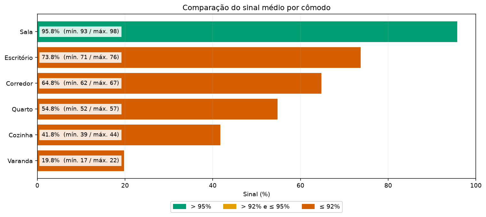
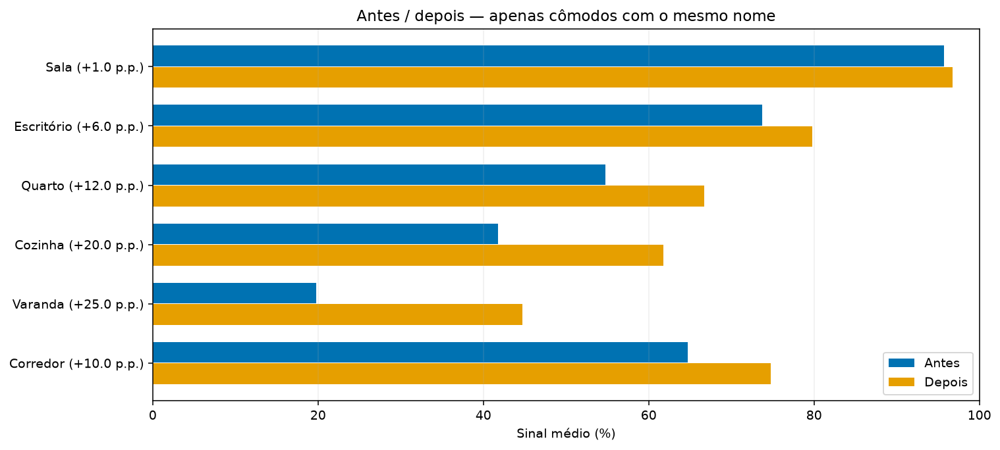

<p align="center">
  
</p>

# BatSignal

**Understand your Wi-Fi coverage, one room at a time.**

BatSignal is a Windows desktop application for recording and comparing Wi-Fi signal strength across rooms. Collect measurements, inspect charts, compare surveys before and after a change, and export results as JSON or Excel.

Built with Python, Tkinter, Matplotlib, and openpyxl. The interface is in Portuguese; the collector recognizes Portuguese, English, Spanish, French, and German `netsh` field labels.

## Features

- **Configurable collection:** choose a room, duration, sampling interval, and optional Wi-Fi interface.
- **Responsive controls:** follow live readings, view progress, and cancel a collection.
- **Network context:** new readings include SSID, BSSID, interface name, and a timestamp with UTC offset. The log highlights network changes during collection.
- **Reliable local storage:** validated JSON, safe filenames, atomic saves, legacy-file imports, and prompts for unsaved work.
- **Clear charts:** full 0–100% signal scales, reusable colors and markers, and room summaries.
- **Before/after comparison:** compare rooms with matching names in two saved surveys.
- **Excel reports:** one worksheet per room plus a summary; worksheet names are cleaned and deduplicated automatically.

Signal percentage is reported by Windows. It does not measure internet speed, latency, packet loss, or guarantee connection quality.

## Quick start

### Portable Windows build

If you have a `BatSignal-Windows.zip` build, extract the **entire archive** and run `BatSignal/BatSignal.exe`. Keep the executable and its `_internal/` folder together. Python installation is not required for this build.

The portable build is unsigned. There is currently no installer or automatic update mechanism.

### Run from source

Requirements: Windows, an active Wi-Fi connection, and **Python 3.12 or 3.13 with Tkinter**. Python 3.12 is used for the local build; the CI workflow is configured to check both versions.

Run in PowerShell:

```powershell
git clone https://github.com/theycallmefreire/BatSignal-wifi.git
cd BatSignal-wifi
python -m venv .venv
.\.venv\Scripts\python.exe -m pip install -r requirements.txt
.\.venv\Scripts\python.exe app_main.py
```

Check `python --version` before creating the environment. Virtual-environment activation is optional when using its interpreter directly. The old `requeriments.txt` filename is retained as a compatibility alias.

## Usage

1. Connect to the Wi-Fi network you want to evaluate.
2. Enter a room name in **Cômodo**. For multiple locations in one room, use names such as `Office - Desk` and `Office - Door`.
3. Set **Duração (s)** and **Intervalo (s)**. Defaults are 60 and 5 seconds. Both must be positive integers, with the interval no greater than the duration.
4. Leave **Interface (opcional)** blank if there is only one connected Wi-Fi adapter. Otherwise, enter its name as shown by `netsh wlan show interfaces`.
5. Click **Iniciar coleta** and keep the computer in place. **Cancelar coleta** discards the current attempt while preserving existing room data.
6. Review the summary. Use **Próximo cômodo** for another location or **Refazer coleta** to repeat the last room.
7. Click **Ver gráficos** to inspect readings and room averages.
8. Name the survey and use **Salvar JSON**. **Exportar Excel** creates a separate workbook.
9. Use **Carregar JSON** to choose a saved survey or import a JSON file from another location.

A successful collection using an existing room name replaces that room after confirmation. Cancelled, empty, and unexpectedly failed collections leave its previous readings intact. Temporary collection errors are displayed in the log; if a collection completes with valid readings, those readings are kept.

### Compare before and after

Save separate surveys before and after changing your setup, then click **Comparar antes/depois** and select the two JSON files in order.

Only rooms with **exactly matching names** are compared. The chart shows average signal and the change in **percentage points**. Use the same device, orientation, locations, and sampling settings for meaningful comparisons. Comparison does not modify either survey.

The [example surveys](examples/) contain synthetic measurements that can be imported without running a real Wi-Fi collection.

## Charts

These charts were rendered by BatSignal using the synthetic surveys in `examples/`.





The line chart uses measurement number on the horizontal axis and shows a dashed average for each room. It does not imply that samples in different rooms were taken simultaneously.

The bar chart ranks rooms by average signal and shows minimum/maximum values. Its application-specific color boundaries are:

| Average signal | Color |
| --- | --- |
| Greater than 95% | Green |
| Greater than 92%, up to and including 95% | Orange |
| 92% or lower | Vermilion |

These thresholds are visual aids, not networking standards.

## Storage and exports

- **Source checkout:** surveys and rotating logs are stored in `dados/` next to the source files, regardless of the launch directory.
- **Portable build:** surveys and logs are stored in `%LOCALAPPDATA%\BatSignal\dados`.
- **Custom location:** set the `BATSIGNAL_DATA_DIR` environment variable before launching.
- JSON writes and Excel exports use a temporary file followed by replacement, protecting an existing file if writing fails.
- JSON saving and Excel export are separate actions. Exporting a workbook does not mark the JSON survey as saved.

New surveys use schema version 2. Older files containing `nome`, `data`, and `comodos` remain supported.

```json
{
  "schema_version": 2,
  "nome": "Home - Baseline",
  "data": "2026-04-01T14:30:00-03:00",
  "comodos": {
    "Office": [
      {
        "tempo": "14:29:00",
        "timestamp": "2026-04-01T14:29:00-03:00",
        "forca": 74,
        "interface": "Wi-Fi",
        "ssid": "Example network",
        "bssid": "02:00:00:00:00:01"
      }
    ]
  }
}
```

The original Portuguese keys are preserved for compatibility. Excel includes these reading fields and a **Resumo** worksheet with room names, worksheet mappings, minimum, maximum, average, and sample count. Surveys may contain network identifiers and room names; review them before sharing.

## Troubleshooting

| Problem | What to check |
| --- | --- |
| No readings | Run `netsh wlan show interfaces`; check that Wi-Fi is connected and a signal percentage is present. |
| Windows refuses the query | Check the WLAN service and Windows location permissions. BatSignal does not change these settings. |
| Multiple connected adapters | Fill in the optional Interface field with the intended adapter name. |
| Unsupported output language | Current parsing recognizes PT/EN/ES/FR/DE labels. Other languages require a collector update. |
| Excel cannot be saved | Close the destination workbook in Excel and verify that the selected folder is writable. |
| A survey does not appear | Invalid JSON files are skipped when listing surveys. Import the file directly to see its validation error. |
| Missing Python module | Install `requirements.txt` using the same virtual environment used to launch the app. |
| Unexpected error | Check `batsignal.log` in the data directory. |

## Development

```powershell
.\.venv\Scripts\python.exe -m pip install -r requirements-dev.txt
.\.venv\Scripts\python.exe -m ruff check .
.\.venv\Scripts\python.exe -m ruff format --check .
.\.venv\Scripts\python.exe -m pytest -q
.\.venv\Scripts\python.exe scripts/build_windows.py
```

The build command produces `dist/BatSignal-Windows.zip`. GitHub Actions runs Windows tests for Python 3.12/3.13 and creates a build artifact after checks pass.

| Module | Responsibility |
| --- | --- |
| `app_main.py` | Tkinter interface and main-thread event handling |
| `wifi_coleta.py` | netsh parsing, collection worker, and cancellation |
| `wifi_dados.py` | JSON validation and local persistence |
| `wifi_exportacao.py` | Safe Excel export |
| `wifi_graficos.py` | Charts and survey comparison |
| `app_paths.py` | Resource and storage paths |

Read [CONTRIBUTING.md](CONTRIBUTING.md) for development guidance and [ROADMAP.md](ROADMAP.md) for priorities and remaining work. Real Wi-Fi behavior still needs validation across hardware and Windows configurations. A floor-plan heatmap and Linux/macOS collectors are future work.

## License

Licensed under the [Apache License 2.0](LICENSE). See [NOTICE](NOTICE) for attribution. Third-party dependencies retain their own licenses; the portable build includes their notices.
